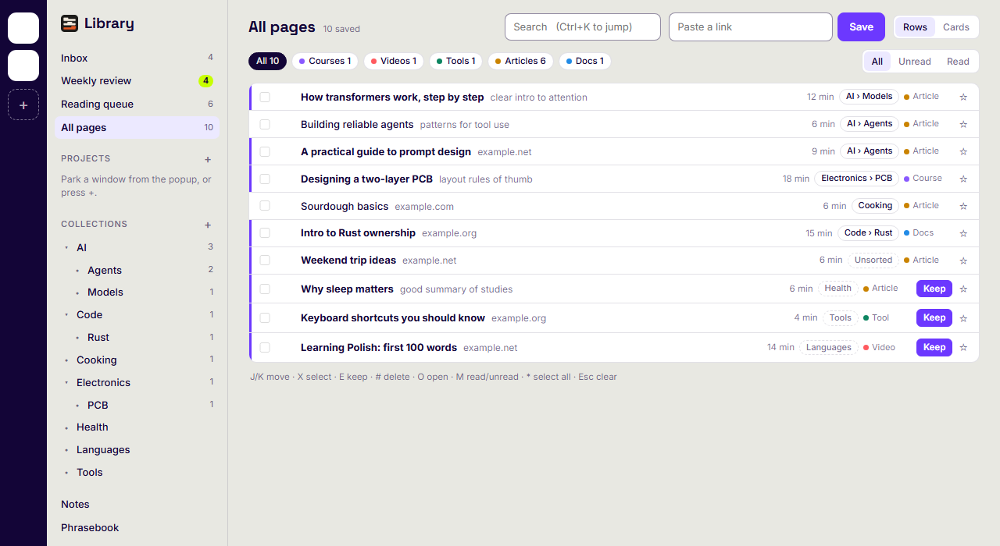

# pinax

a chrome extension to save pages for later, sort them into collections, and keep your tabs tidy.

sorting uses chrome's built-in ai (gemini nano). it runs on your computer, no account or api key needed. without it, simple rules are used.

## install

easiest way (no git needed):

1. download `pinax-extension.zip` from the [latest release](../../releases/latest) and unzip it
2. open `chrome://extensions` and turn on developer mode (top right)
3. click **load unpacked** and pick the unzipped folder
4. pin it from the puzzle-piece menu

or clone this repo and pick the repo folder in step 3. to update, download the new zip (or `git pull`) and press the reload arrow on the extension card.

chrome only installs extensions outside its web store this way (developer mode). needs chrome 138 or newer on desktop.

## use

- save the current page with `alt+shift+s`, or from the popup
- open the library with `alt+shift+l`
- organise the tabs of a window into groups with `alt+shift+o`
- highlight text on a page and keep notes
- take your pages with you any time: settings (the gear in the library) › export **bookmarks** (a file any browser imports) or **csv** (spreadsheet)

all data stays in your browser. the only thing that reaches the internet is the weekly update check: it asks github for the latest release number and shows a link if there is a newer one. it never downloads or installs anything, and sends nothing else. untick **check for updates weekly** in settings (the gear in the library) to turn it off (then pinax makes no network requests at all).

you can also hear about new versions through github's **watch › custom › releases** on this repo.

more details in [docs/features.md](docs/features.md).

license: [MIT](LICENSE)
