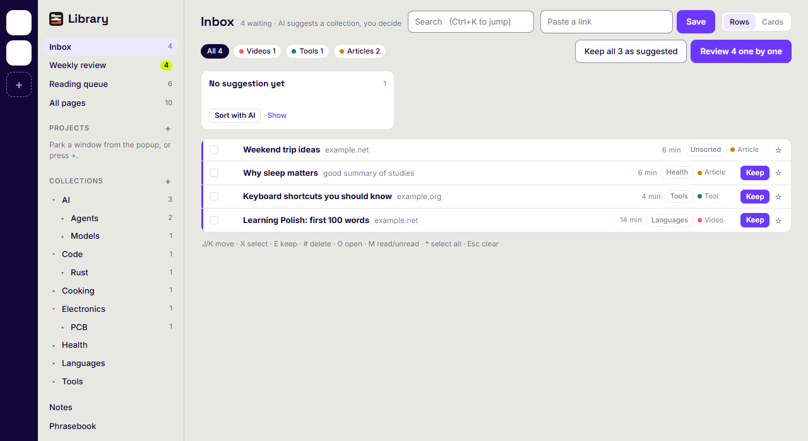
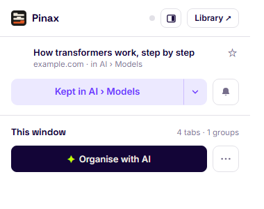

# pinax

a chrome extension to save pages for later, sort them into collections, and keep your tabs tidy.

sorting uses chrome's built-in ai (gemini nano). it runs on your computer, no account or api key needed. without it, simple rules are used.

## install

1. download or clone this repo
2. open `chrome://extensions` and turn on developer mode
3. click load unpacked and pick this folder

needs chrome 138 or newer.

## use

- save the current page with `alt+shift+s`, or from the popup
- open the library with `alt+shift+l`
- organise the tabs of a window into groups with `alt+shift+o`
- highlight text on a page and keep notes

all data stays in your browser. more details in [docs/features.md](docs/features.md).
